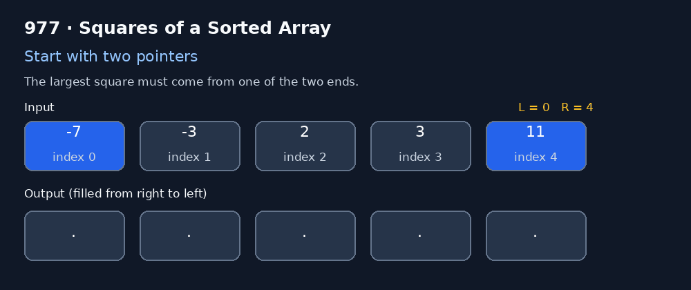

# 977. Squares of a Sorted Array

[](https://leetcode.com/problems/squares-of-a-sorted-array/)
[](https://www.python.org/)

> Square every number in a non-decreasing sorted array and return the squares in non-decreasing order. 🚀

## 🧩 Problem intuition

The input array is already sorted, but it may contain negative numbers. Squaring removes the sign, so the order can change.

For example:

```text
nums   = [-7, -3, 2, 3, 11]
squares = [49, 9, 4, 9, 121]
answer  = [4, 9, 9, 49, 121]
```

The key observation: **the largest square is always at one of the two ends** of the current array. The most negative value or the largest positive value has the greatest absolute value.

---

## 🐢 1. Brute-force solution — square, then sort

### Approach

1. Square every element.
2. Sort the resulting values in ascending order.
3. Return the sorted list.

### Python 3

```python
class Solution:
    def sortedSquares(self, nums: List[int]) -> List[int]:
        return sorted(x * x for x in nums)
```

### Complexity

- **Time:** `O(n log n)` — squaring takes `O(n)` and sorting takes `O(n log n)`.
- **Auxiliary space:** `O(n)` — the generated values and sorted result require linear storage.

This is concise and correct. It does not fully exploit the fact that the original array is sorted.

---

## ⚡ 2. Optimal solution — two pointers

### Hints & tricks 💡

- Keep one pointer at the beginning (`left`) and one at the end (`right`).
- Compare `abs(nums[left])` with `abs(nums[right])`.
- The larger absolute value produces the largest remaining square.
- Fill the answer **from right to left**, so every selected maximum lands in its final position.
- Move only the pointer whose value was selected.

### Python 3

```python
class Solution:
    def sortedSquares(self, nums: List[int]) -> List[int]:
        n = len(nums)
        result = [0] * n
        left, right = 0, n - 1

        for position in range(n - 1, -1, -1):
            if abs(nums[left]) > abs(nums[right]):
                result[position] = nums[left] * nums[left]
                left += 1
            else:
                result[position] = nums[right] * nums[right]
                right -= 1

        return result
```

### 🎬 Pointer animation

The animation below walks through `nums = [-7, -3, 2, 3, 11]`. At each step, the larger square is placed into the rightmost unfilled output position.



### Step-by-step walkthrough

| Step | Left value | Right value | Chosen square | Output position |
|---:|---:|---:|---:|---:|
| 1 | -7 | 11 | 121 | 4 |
| 2 | -7 | 3 | 49 | 3 |
| 3 | -3 | 3 | 9 | 2 |
| 4 | -3 | 2 | 9 | 1 |
| 5 | 2 | 2 | 4 | 0 |

Final result:

```text
[4, 9, 9, 49, 121]
```

### Complexity

- **Time:** `O(n)` — each pointer moves inward at most `n` times, and each position is written once.
- **Auxiliary space:** `O(1)` excluding the output array.
- **Output space:** `O(n)` for the returned list.

---

## 🧠 Why does the two-pointer method work?

Because `nums` is sorted, the element with the greatest absolute value among the remaining elements must be at either the left or right boundary. Its square is therefore the largest square not yet placed.

Placing that value at the current last free position preserves the required order. Repeating this process until the pointers cross fills the result from largest to smallest, from right to left.

## 🏁 Quick comparison

| Method | Time | Auxiliary space | Uses input ordering? |
|---|---:|---:|---|
| Square + sort | `O(n log n)` | `O(n)` | No |
| Two pointers | `O(n)` | `O(1)` excluding output | Yes |

**Takeaway:** When an array is sorted but a transformation disrupts its order, inspect the boundaries. A two-pointer strategy may avoid a full sort. Keep practising! 🌟
