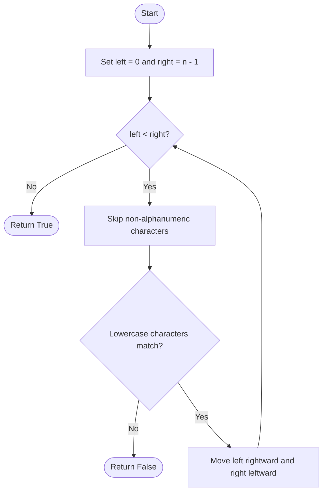

<div align="center">

# 🚀 LeetCode 125 — Valid Palindrome

### 🐍 Python 3 | Easy | Strings & Two Pointers

[](https://leetcode.com/problems/valid-palindrome/)
[](https://www.python.org/)
[](https://leetcode.com/tag/two-pointers/)

**Clean the string. Compare both ends. Find the palindrome! ✨**

</div>

---

## 🧩 Problem Summary

A string is a **valid palindrome** if, after converting uppercase letters to lowercase and removing all non-alphanumeric characters, it reads the same forward and backward.

**Examples**

| Input | Normalized string | Output |
|---|---|---|
| `"A man, a plan, a canal: Panama"` | `"amanaplanacanalpanama"` | `True` ✅ |
| `"race a car"` | `"raceacar"` | `False` ❌ |
| `" "` | `""` | `True` ✅ |

**Key detail:** An empty string is considered a palindrome.

---

## 1️⃣ Brute-Force Solution — Build and Reverse

### 💡 Idea

1. Keep only letters and digits.
2. Convert each retained character to lowercase.
3. Reverse the cleaned string.
4. Compare the cleaned string with its reverse.

### 🧑‍💻 Python 3

```python
class Solution:
    def isPalindrome(self, s: str) -> bool:
        cleaned = ''.join(
            c.lower() for c in s if c.isalnum()
        )
        reversed_cleaned = cleaned[::-1]
        return cleaned == reversed_cleaned
```

### ⏱️ Complexity

- **Time:** `O(n)` — cleaning, reversing, and comparing each take linear time.
- **Space:** `O(n)` — the cleaned and reversed strings require linear additional space.

Here, `n` is the length of the input string.

### 🔎 Why call it brute force?

This is a straightforward baseline: construct a normalized copy and another reversed view/string before comparing. Python slicing is concise, but it uses additional memory for the reversed result in the general complexity analysis.

---

## 2️⃣ Optimal Solution — Two Pointers 🎯

### 💡 Hint

**Can the two ends be compared directly, without building a cleaned string?**

Use two indices:
- `left` starts at the beginning.
- `right` starts at the end.
- Skip any character that is not alphanumeric.
- Compare the lowercase versions of the current characters.
- If they differ, return `False`; otherwise move inward.

### 🧑‍💻 Python 3

```python
class Solution:
    def isPalindrome(self, s: str) -> bool:
        left, right = 0, len(s) - 1

        while left < right:
            while left < right and not s[left].isalnum():
                left += 1

            while left < right and not s[right].isalnum():
                right -= 1

            if s[left].lower() != s[right].lower():
                return False

            left += 1
            right -= 1

        return True
```

### ⏱️ Complexity

- **Time:** `O(n)` — each pointer moves only inward, so each character is examined at most a constant number of times.
- **Auxiliary space:** `O(1)` — only two indices and temporary character comparisons are used; the input string is not copied.

**Why is this better?** Both methods take linear time, but the two-pointer method avoids constructing a cleaned string and its reverse.

---

## 🎞️ Two-Pointer Animation (Step by Step)

Example: `s = "A man, a plan, a canal: Panama"`

The pointers move toward the center. Punctuation and spaces are skipped; letters are compared case-insensitively.

```text
Step 1: A man, a plan, a canal: Panama
        ^                           ^
        A                           a
        Match ✅

Step 2: A man, a plan, a canal: Panama
         ^                         ^
         m                         m
         Match ✅

Step 3: A man, a plan, a canal: Panama
          ^                       ^
          a                       a
          Match ✅

        ... continue inward ...

Final:  All matching pairs checked
        left >= right
        Return True 🎉
```

### 🧭 Pointer movement



---

## ⚡ Tips, Tricks & Interview Hints

- **Normalize before comparing:** Lowercase and remove punctuation/spaces when using the simple approach.
- **Use `str.isalnum()`:** It checks whether a character is a letter or digit.
- **Use `.lower()` for case-insensitive comparison:** For this problem, comparing lowercase characters is sufficient.
- **Check pointer bounds while skipping:** `left < right` prevents the pointers from crossing during the inner loops.
- **Return early on a mismatch:** A single unequal pair proves the string is not a palindrome.
- **Do not overcomplicate the center:** If the pointers meet or cross, all required pairs have matched.
- **Remember Unicode:** Python's `isalnum()` recognizes many Unicode letters and digits, not just ASCII characters.

### 🧪 Edge Cases to Test

| Input | Expected | Reason |
|---|---:|---|
| `""` | `True` | Empty string |
| `" "` | `True` | No alphanumeric characters |
| `"a"` | `True` | Single character |
| `"Aa"` | `True` | Case-insensitive match |
| `"0P"` | `False` | Mismatched alphanumeric characters |
| `".,!"` | `True` | No alphanumeric characters |

---

## 🏁 Which Solution Should You Submit?

| Approach | Time | Auxiliary space | Main trade-off |
|---|---:|---:|---|
| Clean + reverse | `O(n)` | `O(n)` | Very concise and readable |
| Two pointers | `O(n)` | `O(1)` | Avoids extra string construction |

**Recommendation:** Use the **two-pointer solution** when optimizing auxiliary space. Your original solution is also correct and is an excellent concise Python solution. ✅

---

<div align="center">

### 🌟 Think clearly. Move inward. Match every pair.

**Problem #125 complete — keep solving, keep growing! 🚀**

</div>
