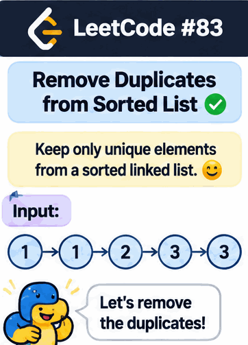

<div align="center">

# 🧹 LeetCode 83 — Remove Duplicates from Sorted List

### Keep the unique nodes. Skip the duplicates. Keep the list clean! ✨


-brightgreen)
-blue)

**A focused guide to brute force, pointer manipulation, and the optimal in-place solution.**

</div>

---

## 🎯 Problem Overview

Given the `head` of a **sorted linked list**, delete all duplicates so that each value appears only once. Return the linked list after removing the duplicates.

Because the list is sorted, equal values are always adjacent. This property makes it possible to remove duplicates by comparing each node with its immediate successor.

### Example 1

```text
Input:  head = [1, 1, 2]
Output: [1, 2]
```

### Example 2

```text
Input:  head = [1, 1, 2, 3, 3]
Output: [1, 2, 3]
```

### Constraints

- The number of nodes is in the range `[0, 300]`.
- `-100 <= Node.val <= 100`.
- The linked list is sorted in **non-decreasing** order.

---

## 🐢 Approach 1: Brute Force — Compare Every Remaining Node

### 💡 Intuition

For each node, scan every node that comes after it. Whenever a later node has the same value, remove that later node by changing the previous node's `next` pointer.

This approach does not take advantage of the sorted order. It repeatedly checks nodes that the optimal solution would not need to inspect.

### 🧩 Python 3 Solution

```python
class Solution:
    def deleteDuplicates(self, head):
        curr = head

        while curr:
            runner = curr

            while runner.next:
                if runner.next.val == curr.val:
                    runner.next = runner.next.next
                else:
                    runner = runner.next

            curr = curr.next

        return head
```

### 🔍 How It Works

1. `curr` selects the node whose value is being checked.
2. `runner` scans the remaining list.
3. If `runner.next.val == curr.val`, the later duplicate is bypassed.
4. Otherwise, `runner` advances.
5. Move `curr` forward and repeat.

### Complexity Analysis

| Complexity | Cost | Explanation |
|---|---:|---|
| Time | `O(n²)` | Each node may scan most of the remaining list. |
| Auxiliary space | `O(1)` | Only two pointers are used. |

---

## 🚀 Approach 2: Optimal — One-Pass Pointer Manipulation

<badge color="success">Recommended solution</badge>

### 💡 Key Observation

The input list is already sorted. Therefore, duplicates can only occur next to one another.

There is no need for:
- A nested loop.
- A hash set.
- An additional linked list.
- A second traversal.

Simply compare the current node with the next node.

### 🧠 Step-by-Step Algorithm

1. Initialize `curr = head`.
2. Continue while `curr` and `curr.next` both exist.
3. If their values are equal, skip the next node:
   `curr.next = curr.next.next`
4. Otherwise, advance the current pointer:
   `curr = curr.next`
5. Return the original `head`.

**Important pointer trick:** When a duplicate is removed, do not advance `curr`. Its new next node may also be a duplicate.

### 🎬 Visual Animation

The animation illustrates how adjacent duplicate nodes are bypassed while the current pointer stays in place until a distinct value is found.



### 🧪 Optimal Python 3 Solution

```python
class Solution:
    def deleteDuplicates(self, head):
        curr = head

        while curr and curr.next:
            if curr.val == curr.next.val:
                curr.next = curr.next.next
            else:
                curr = curr.next

        return head
```

### 🔬 Dry Run

**Input:**

```text
1 → 1 → 2 → 3 → 3 → None
```

| Step | `curr.val` | `curr.next.val` | Action | List |
|---:|---:|---:|---|---|
| 1 | 1 | 1 | Skip duplicate | `1 → 2 → 3 → 3` |
| 2 | 1 | 2 | Move `curr` | `1 → 2 → 3 → 3` |
| 3 | 2 | 3 | Move `curr` | `1 → 2 → 3 → 3` |
| 4 | 3 | 3 | Skip duplicate | `1 → 2 → 3` |
| 5 | 3 | None | Stop | `1 → 2 → 3` |

**Output:**

```text
1 → 2 → 3 → None
```

### ⏱️ Complexity Analysis

| Complexity | Cost | Explanation |
|---|---:|---|
| Time | `O(n)` | Each node is visited a constant number of times. |
| Auxiliary space | `O(1)` | The algorithm uses only the `curr` pointer. |

The solution modifies the existing linked list in place; it does not create a new list.

---

## 🧠 Interview Tips, Tricks & Hints

- **Exploit sorted order:** Equal values are adjacent, so compare only neighboring nodes.
- **Use two-node lookahead:** The loop condition `curr and curr.next` ensures both nodes exist before accessing their values.
- **Do not move after deletion:** After bypassing a duplicate, check the new successor of the same current node.
- **Preserve the head:** Return `head`, not `curr`, because `curr` moves through the list.
- **Handle an empty list:** If `head` is `None`, the loop is skipped and `None` is returned.
- **Handle a single node:** There is no successor to compare, so the original list is returned unchanged.

### ⚠️ Common Mistake

Incorrect:

```python
if curr.val == curr.next.val:
    curr.next = curr.next.next
    curr = curr.next  # Avoid advancing here!
```

Advancing immediately after deletion can skip a duplicate that has moved into the next position.

Correct:

```python
if curr.val == curr.next.val:
    curr.next = curr.next.next
else:
    curr = curr.next
```

---

## ⚖️ Brute Force vs. Optimal

| Feature | Brute Force | Optimal |
|---|---:|---:|
| Strategy | Repeated scanning | Adjacent comparison |
| Time | `O(n²)` | `O(n)` |
| Auxiliary space | `O(1)` | `O(1)` |
| In-place | Yes | Yes |
| Uses sorted property | No | Yes |

---

## 🏁 Final Takeaway

The central lesson of LeetCode 83 is that **a sorted linked list makes duplicate removal a one-pass problem**.

The key operation is:

```python
curr.next = curr.next.next
```

It removes a duplicate by bypassing the node, without shifting elements or allocating extra memory.

<details>
<summary>🌟 Quick revision</summary>

- Compare `curr` with `curr.next`.
- If equal, unlink the next node.
- If different, advance `curr`.
- Return the original head.
- **Time:** `O(n)`
- **Auxiliary space:** `O(1)`

</details>

<div align="center">

### 🎉 One pass. Constant space. No duplicates!

**Keep practising. Keep optimizing. Keep moving forward. 🚀**

</div>
