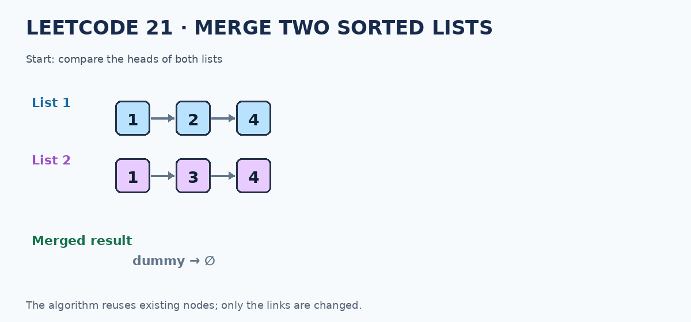

<div align="center">

# 🔗 LeetCode 21 — Merge Two Sorted Lists

### Merge two sorted linked lists into one sorted linked list.


**A practical guide to brute force, pointer manipulation, and an optimal in-place merge.**

</div>

---

## 🎯 Problem Statement

You are given the heads of two sorted singly linked lists, `list1` and `list2`.

Merge the two lists into one sorted linked list. The merged list should be made by splicing together the nodes of the first two lists.

Return the head of the merged linked list.

**Example**

```text
Input:  list1 = [1,2,4], list2 = [1,3,4]
Output: [1,1,2,3,4,4]
```

**Constraints (conceptual):** Both input lists are sorted in non-decreasing order. Either list may be empty.

---

## 🧠 Hints Before Looking at the Solution

1. Since both lists are already sorted, do not sort all values again unless using a simple baseline.
2. Compare only the current head of each list. The smaller node must be next in the merged list.
3. Advance the pointer in the list from which the node was selected.
4. A **dummy node** provides a stable starting point and avoids special handling for the first selected node.
5. Once one list becomes empty, append the other list: it is already sorted.

<details>
<summary>💡 Key trick: Why use a dummy node?</summary>

The dummy node is a temporary node placed before the actual result. A `cur` pointer tracks the last node in the merged list. This makes every insertion follow the same two operations:

```python
cur.next = selected_node
cur = selected_node
```

The actual answer begins at `dummy.next`; the dummy itself is not returned.

</details>

---

## 🐢 1. Brute-Force Approach — Collect, Sort, Rebuild

### Idea

Traverse both linked lists, collect every value in an array, sort the array, and construct a new linked list from the sorted values.

### Python 3 Solution

```python
class Solution:
    def mergeTwoLists(self, list1, list2):
        values = []

        while list1:
            values.append(list1.val)
            list1 = list1.next

        while list2:
            values.append(list2.val)
            list2 = list2.next

        values.sort()

        dummy = ListNode()
        cur = dummy

        for value in values:
            cur.next = ListNode(value)
            cur = cur.next

        return dummy.next
```

### Complexity Analysis

Let `m` and `n` be the lengths of the two input lists, and let `N = m + n`.

| Metric | Complexity | Reason |
|---|---|---|
| Time | `O(N log N)` | Sorting all `N` values dominates traversal and reconstruction. |
| Auxiliary space | `O(N)` | The array stores all values; the rebuilt list also contains `N` new nodes. |

**Trade-off:** This approach is straightforward, but it ignores the fact that the input lists are already sorted. It also creates new nodes instead of reusing the original ones.

---

## 🚀 2. Optimal Approach — Two Pointers + Dummy Node

<badge color="success">Recommended</badge> <badge color="success">O(m + n) time</badge>

### Core Idea

Because both linked lists are sorted, the smallest remaining value must always be at one of their two current heads.

Maintain:
- `list1`: current node in the first list.
- `list2`: current node in the second list.
- `dummy`: temporary node before the merged list.
- `cur`: last node in the merged list.

At each iteration:
1. Compare `list1.val` and `list2.val`.
2. Link the smaller node to `cur.next`.
3. Advance the selected input pointer and `cur`.
4. When either list ends, attach the remaining nodes directly.

### Python 3 — Optimal Solution

```python
class Solution:
    def mergeTwoLists(self, list1: Optional[ListNode],
                      list2: Optional[ListNode]) -> Optional[ListNode]:

        cur = dummy = ListNode()

        while list1 and list2:
            if list1.val < list2.val:
                cur.next = list1
                list1, cur = list1.next, list1
            else:
                cur.next = list2
                list2, cur = list2.next, list2

        if list1 or list2:
            cur.next = list1 if list1 else list2

        return dummy.next
```

### 🔍 Understanding the Pointer Update

Consider this statement:

```python
list1, cur = list1.next, list1
```

Python evaluates the right-hand side before assigning either variable. Therefore:
- `cur` becomes the node that was just attached.
- `list1` advances to the next node.

This compact tuple assignment preserves the correct node references.

The final connection:

```python
cur.next = list1 if list1 else list2
```

is safe because the remaining list is already sorted and every value in it is greater than or equal to the last selected value.

---

## 🎬 Animated Visualization

Watch the two sorted lists merge one node at a time. The green row is the result being constructed.



**Example:** `1 → 2 → 4` and `1 → 3 → 4` become `1 → 1 → 2 → 3 → 4 → 4`.

---

## 🧪 Dry Run

Input:

```text
List 1: 1 → 2 → 4
List 2: 1 → 3 → 4
```

| Step | Compare | Selected node | Merged list |
|---:|---|---:|---|
| 1 | `1` vs `1` | List 2: `1` | `1` |
| 2 | `1` vs `3` | List 1: `1` | `1 → 1` |
| 3 | `2` vs `3` | List 1: `2` | `1 → 1 → 2` |
| 4 | `4` vs `3` | List 2: `3` | `1 → 1 → 2 → 3` |
| 5 | `4` vs `4` | List 2: `4` | `1 → 1 → 2 → 3 → 4` |
| 6 | List 2 is empty | Attach remaining List 1 | `1 → 1 → 2 → 3 → 4 → 4` |

The implementation uses `<`, so equal values are selected from `list2` first. Using `<=` would select from `list1` first; either choice produces a sorted result.

---

## ⏱️ Complexity Analysis — Optimal Solution

Let `m` be the length of `list1` and `n` be the length of `list2`.

| Metric | Complexity | Explanation |
|---|---|---|
| Time | **`O(m + n)`** | Each node is visited and linked at most once. |
| Auxiliary space | **`O(1)`** | Only a fixed number of pointers are used. |
| Output space | **`O(1)` additional nodes** | Original nodes are reused; no replacement list is allocated. |

The algorithm is optimal in time complexity: in the general case, the nodes of both lists must be examined to produce the merged order.

---

## ⚡ Tips, Tricks & Interview Insights

| Technique | Why it helps |
|---|---|
| Dummy node | Eliminates special handling for the first node. |
| Two pointers | Uses the sorted property instead of sorting again. |
| Reuse nodes | Avoids allocating a new node for every value. |
| Attach the remainder | Avoids unnecessary comparisons after one list ends. |
| Tuple assignment | Updates the input pointer and merged-tail pointer together. |

### Common Mistakes to Avoid

- **Forgetting to advance a pointer:** This can cause an infinite loop.
- **Returning `dummy` instead of `dummy.next`:** The dummy is not part of the answer.
- **Rebuilding every node unnecessarily:** The optimal solution reuses existing nodes.
- **Merging without checking for an empty input:** The remainder-attachment step handles this naturally.
- **Overcomplicating the final loop:** The unprocessed suffix is already sorted and can be attached directly.

---

## 🧩 Edge Cases

| Input | Expected result |
|---|---|
| `[]`, `[]` | `[]` |
| `[1,3,5]`, `[]` | `[1,3,5]` |
| `[]`, `[2,4,6]` | `[2,4,6]` |
| `[1,2]`, `[3,4]` | `[1,2,3,4]` |
| `[3,4]`, `[1,2]` | `[1,2,3,4]` |
| `[1,1]`, `[1,1]` | `[1,1,1,1]` |

---

## 🏆 Final Takeaway

The key observation is that **merging two sorted linked lists does not require sorting**. At every step, the smallest remaining node is one of the two current heads.

- Brute force: collect values, sort, and rebuild — `O((m+n) log(m+n))` time and `O(m+n)` space.
- Optimal: compare heads, relink nodes, and append the remainder — `O(m+n)` time and `O(1)` auxiliary space.

**Remember:** Dummy node + two pointers + attach the remainder = clean linked-list merging. 🎯

<div align="center">

### Keep practising. Keep linking. Keep solving! 💻✨

</div>
